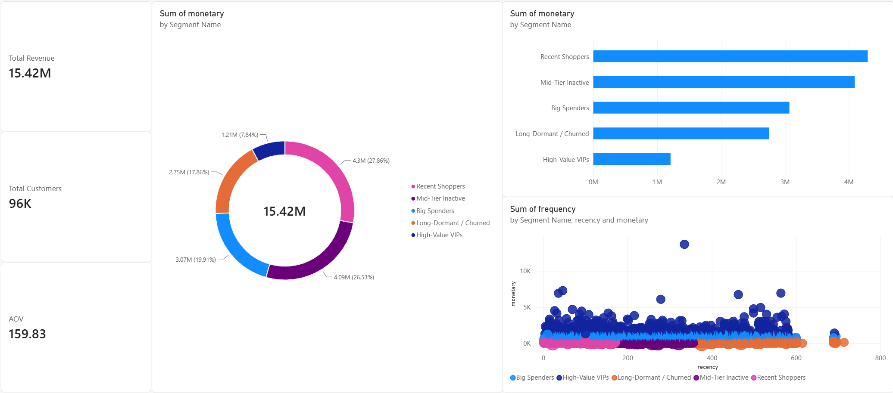

# Automated RFM Customer Segmentation & Machine Learning Pipeline

An end-to-end data engineering, unsupervised machine learning, and business intelligence project built on the full **Brazilian E-Commerce Public Dataset by Olist**. This project ingests tens of thousands of customer records from a relational database, extracts RFM behavioral metrics, implements K-Means clustering to segment the customer base, and visualizes the insights via Python and Power BI.

---

## 📌 Executive Summary
Understanding customer lifetime value and behavior is critical for scaling e-commerce operations. This project automates customer tiering by transforming raw transactional logs into actionable cohorts. Using **K-Means Clustering ($K=5$)**, the pipeline successfully isolates high-value VIP spenders, big spenders, active shoppers, and dormant accounts, equipping marketing teams with targeted retention strategies.

---

## 🏗️ Project Architecture & Tech Stack
* **Database & Extraction:** MySQL (`olist_db`), Pandas, SQLAlchemy
* **Machine Learning & Feature Engineering:** Scikit-Learn (`KMeans`, `StandardScaler`), NumPy
* **Visualization & BI:** Seaborn, Matplotlib, Power BI (DAX measures, interactive canvas)
* **Language:** Python

---

## ⚙️ Methodology & Pipeline Steps

1. **Data Engineering & Ingestion:**
   * Imported core tables (`customers`, `orders`, `order_items`) into a local MySQL database.
   * Filtered records for successfully delivered orders to ensure data integrity.

2. **RFM Feature Extraction:**
   Calculated three core behavioral metrics for every unique customer:
   * **Recency (R):** Days elapsed since the customer's last purchase relative to a fixed snapshot date.
   * **Frequency (F):** Total number of distinct orders placed.
   * **Monetary (M):** Total financial investment per customer (sum of item price plus freight value).

3. **Unsupervised Machine Learning ($K$-Means):**
   * Normalized features using `StandardScaler` to prevent feature dominance.
   * Executed the **Elbow Method** across $K = 1$ to $10$, identifying an optimal bend at $K = 5$ balancing statistical variance reduction with business interpretability.
   * Trained the final K-Means model to assign a unique cluster ID to every customer record.

4. **Business Intelligence & Export:**
   * Exported segmented data back to MySQL and CSV for deployment.
   * Built an executive Power BI dashboard utilizing custom DAX measures and interactive visualizations.

---

## 📊 Customer Segment Profiles & Strategic Recommendations

| Cluster ID | Segment Name | Approximate Size | Characteristics | Strategic Marketing Action |
| :--- | :--- | :--- | :--- | :--- |
| **Cluster 3** | High-Value VIPs | ~6,274 | Elite spenders (~$1,928 avg monetary) | Priority support, early access to product launches, exclusive loyalty tiers. |
| **Cluster 4** | Big Spenders | ~4,606 | High upper-middle spend (~$666 avg monetary) | Cross-sell premium category bundles and high-margin product lines. |
| **Cluster 0** | Active Shoppers | ~34,619 | Recent buyers (~88 days recency), baseline spend (~$124) | Post-purchase follow-up reviews, recommendation engines for secondary accessories. |
| **Cluster 2** | Mid-Tier Inactive | ~34,569 | Moderate recency (~256 days), low spend | Automated "We miss you" email campaigns featuring tailored incentive discounts. |
| **Cluster 1** | Long-Dormant / Churned | ~22,057 | High recency (~459 days), low engagement | Low-cost win-back drip sequences or automated reactivation offers. |

---

## 📈 Power BI Executive Dashboard Features
* **KPI Top Banner:** Real-time metrics tracking Total Revenue, Total Unique Customers, and Average Order Value (AOV).
* **Segment Distribution Donut Chart:** Highlights customer volume distribution across tiers.
* **100% Stacked Bar Chart:** Demonstrates the Pareto Principle (showing how VIP and Big Spenders drive an outsized portion of total revenue).
* **Interactive Scatter Plot:** Maps Recency vs. Monetary value, color-coded by segment with bubble sizes mapped to order frequency.

---

## 🚀 How to Run the Code
1. Clone the repository and configure your local MySQL database (`olist_db`).
2. Run the data ingestion script to load the raw Olist CSV tables.
3. Execute the Jupyter notebook (`olist_analysis.ipynb`) to compute RFM metrics, run the Elbow Method, and train the K-Means model.
4. Import `olist_customer_segments.csv` into Power BI Desktop using the provided DAX schema to explore the interactive dashboard.
